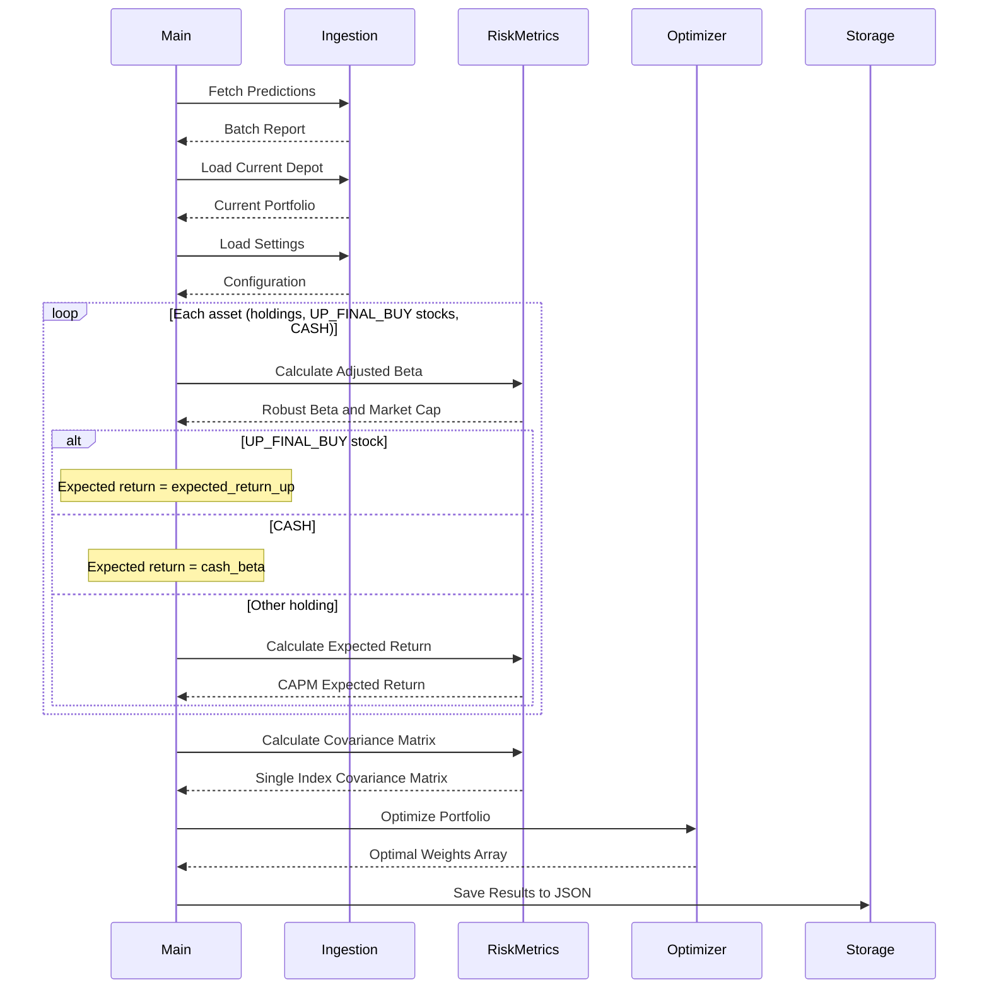

[](https://github.com/kleinnconrad/ml.prediction.depothedging/actions/workflows/run_hedger.yml)
[](https://github.com/kleinnconrad/ml.prediction.depothedging/actions/workflows/ci.yml)

# Depot Hedging Strategist

This repository contains a portfolio hedging engine. It reads the buy candidates of the stock predictor [`ml.prediction.stocks`](https://github.com/kleinnconrad/ml.prediction.stocks) and the current depot, and calculates a robust Beta for each asset. It then searches for the portfolio weights that maximize the expected return, subject to a risk-adjusted return of at least `min_portfolio_return` (2% in `config/settings.yaml`; see [4. Portfolio Optimization](#4-portfolio-optimization)).

## Table of Contents

- [Folder Structure](#folder-structure)
- [Setup and Execution](#setup-and-execution)
- [Continuous Integration](#continuous-integration)
- [Prediction Input](#prediction-input)
  - [Source and Fields](#source-and-fields)
  - [How the Stock Predictor Selects Buy Candidates](#how-the-stock-predictor-selects-buy-candidates)
  - [Changes in Stock Predictor Release 3.0.0](#changes-in-stock-predictor-release-300)
  - [Consequences for the Hedging Engine](#consequences-for-the-hedging-engine)
- [Algorithm and Logic](#algorithm-and-logic)
  - [1. Data Ingestion](#1-data-ingestion)
  - [2. Risk Metrics (Robust Beta)](#2-risk-metrics-robust-beta)
  - [3. Expected Returns (CAPM)](#3-expected-returns-capm)
  - [4. Portfolio Optimization](#4-portfolio-optimization)

## Folder Structure

- `src/`: Core logic of the application.
  - `main.py`: Entry point for the pipeline.
  - `ingestion.py`: Handles fetching remote JSON data and environment secrets.
  - `risk_metrics.py`: Contains custom functions for calculating advanced Beta.
  - `optimizer.py`: Contains the SciPy optimization logic.
- `config/`: Configuration and parameter files.
  - `settings.yaml`: Centralized configuration file for all user-defined parameters and thresholds.
- `tests/`: Offline tests (pytest).
- `.github/workflows/`: GitHub Actions pipelines (hedging engine, pre-merge checks, Release Please).
- `pyproject.toml`: Centralized project configuration, metadata, and dependencies.
- `scripts/`: Standalone utilities (e.g. `update_gist.py` for exporting results).

## Setup and Execution

1. **Environment:** Execute local scripts using the Conda `base` environment to ensure consistency across local development setups. We use `uv` for dependency management to ensure fully reproducible builds. If you introduce new dependencies, add them to the `dependencies` list in `pyproject.toml`, then update the lockfile and your environment:
   ```bash
   uv lock
   uv sync
   ```

2. **Configuration:** All configurable parameters (e.g., target returns, hedging assets, market variance) are located in `config/settings.yaml`. Do not hardcode these in the Python files.

3. **Execution:** 
   For local execution, provide the current depot state as a JSON string via the `CURRENT_DEPOT_JSON` environment variable in a `.env` file at the root of the repository (you can copy `.env.example` to start):
   ```
   CURRENT_DEPOT_JSON={"UN0.DE": 0.5, "ALV.DE": 0.5}
   ```
   Then simply run:
   ```bash
   python -m src.main
   ```
   When executed via GitHub Actions, the `CURRENT_DEPOT_JSON` environment variable is securely injected from the repository's GitHub Secrets.

4. **Results Export:**
   To keep your financial portfolio data private while hosting this algorithm in a public repository, the GitHub Action automatically exports the output (`results.json`) to a Secret GitHub Gist.
   To configure this:
   - Generate a GitHub Personal Access Token (PAT) with the `gist` scope.
   - Add it as a repository secret named `GIST_TOKEN`.
   - The GitHub pipeline will execute `scripts/update_gist.py` to automatically create or update a Secret Gist named `Depot Hedging Strategist - Optimal Weights`.

## Continuous Integration

The `CI` workflow (`.github/workflows/ci.yml`) runs on every pull request and on pushes to `main`. Development tools (pytest, ruff) are in the `dev` dependency group of `pyproject.toml`.

| Job | Checks |
|---|---|
| `Lint` | `uv.lock` matches `pyproject.toml`; `ruff check`; `actionlint` (including `shellcheck`) on the workflow files |
| `Tests` | The tests in `tests/` on Python 3.12 and 3.14. They currently verify that every module in `src/` imports with the locked dependencies. |
| `Conventional Commits` | Every commit of a pull request follows the Conventional Commits format required by Release Please (pull requests only) |
| `CI passed` | Succeeds only if all jobs above succeeded or were skipped; use it as the single required status check in the branch protection of `main` |

Release Please changes the version in `pyproject.toml` but not in `uv.lock`. When it creates or updates a release pull request, the `release-please` workflow (`.github/workflows/release-please.yml`) therefore runs `uv lock` on that branch and pushes the updated `uv.lock` as `chore: update uv.lock for the release`. This push uses the workflow's `GITHUB_TOKEN` and does not start the `CI` workflow; to run the checks on the release pull request before merging, close and reopen it.

Run the Python checks locally before pushing:
```bash
uv lock --check
uv run ruff check .
uv run pytest
```

## Prediction Input

The engine takes its buy candidates from the stock predictor [`kleinnconrad/ml.prediction.stocks`](https://github.com/kleinnconrad/ml.prediction.stocks). This section describes what the engine reads and how the predictor produces it. It describes release 3.x of the predictor. Release 3.0.0 (2026-11-04) replaced the per-stock models of the earlier releases with one model for all stocks.

### Source and Fields

- **Endpoint:** `predictor_url` in `config/settings.yaml` points to `data/processed/full_batch_report.json` on the `main` branch of the predictor repository. The predictor's daily pipeline overwrites this file at the end of each successful run; a failed run leaves the previous report in place.
- **Fields read:** For each entry of the `predictions` list, the engine reads `stock_name` (a Yahoo Finance ticker such as `SAP.DE`, which is also used for the Beta calculation) and `final_prediction` (`NOT_UP`, `UP` or `UP_FINAL_BUY`). Stocks marked `UP_FINAL_BUY` are added to the optimization as buy candidates. The values `UP` and `NOT_UP` have no effect: such stocks are not added, and a holding with either value stays in the optimization with its CAPM return, like a holding that is not in the report (see [3. Expected Returns (CAPM)](#3-expected-returns-capm)).
- **Fields not read:** The engine uses no other field. This includes the per-stock `step1_model` entry (probability and rank) and the top-level `step1_model` summary that release 3.0.0 added (validation results and model gate). The engine does not check `execution_date`.
- **Timing:** Both the predictor pipeline and the hedging workflow are scheduled at 01:00 UTC. From 2026-10-02 to 2026-11-05, GitHub Actions started the scheduled runs of both several hours late, and each hedging run started about 8 to 19 minutes after the scheduled predictor run of the same day. A predictor run of release 2.x took about one hour, so the engine read the report of the previous day. The scheduled run of 2026-11-05, the first on release 3.0.0, failed after about 20 seconds. The first 3.x report came from a later manual run that took about 15 minutes and finished at 09:06 UTC; the hedging run of that day (07:43 UTC) had already read the 2.x report of 2026-11-04. With 3.x run times, the engine can read either the report of the same day or that of the previous day. If a predictor run fails, the file keeps the last successful report, which can be older, and the engine reads it without a warning. The engine does not log which report it read. Each report ranks the stocks of the last closed trading day before its execution (`step1_model.scoring_date`).

### How the Stock Predictor Selects Buy Candidates

The predictor processes about 420 German Xetra stocks in two steps:

1. **Step 1 (ranking):** One logistic regression, fitted on the history of all stocks together, ranks the eligible stocks of the last closed trading day by their estimated probability that the close 126 trading days later is at least 10% above the current close. A stock is eligible if it has at least 253 own trading days, a price above EUR 1, a positive traded value over the last 126 trading days and a last trade at most 5 days old; no other liquidity filter applies. The top 10% of the ranking (`step1_up_share`) are `UP`. In the report of 2026-11-05, 373 stocks were ranked and 37 were `UP`.
   - **Model gate:** On every run, a walk-forward validation over the last 8 years measures how well the ranking separates the stocks that gained at least 10% from the others (cross-sectional AUC). If the lower bound of the 95% confidence interval of this AUC is at or below 0.5, or the interval cannot be computed, no stock is `UP` on that day. The gate also fails, and no stock is ranked, if no final model can be fitted. The report states the result under `step1_model.gate`.
2. **Step 2 (fundamentals):** A ruleset on the current financial statements checks the `UP` stocks. A stock that meets 7 of 10 rules (pro-rated to the rules that apply to the company, with at least 5 applicable) becomes `UP_FINAL_BUY`. In the report of 2026-11-05, 14 of the 37 `UP` stocks passed.

### Changes in Stock Predictor Release 3.0.0

The report fields that the engine reads did not change. Their meaning did:

| | Up to 2.x | From 3.0.0 |
|---|---|---|
| Step 1 model | One model per stock | One model for all stocks |
| Question answered by Step 1 | Is now a good time to own this stock? | Which stocks are more likely than the others to gain 10% over the next 126 trading days? |
| `UP` decision | Per-stock probability cutoff and validation checks | Top 10% of the daily ranking, if the model gate passes |
| `UP_FINAL_BUY` stocks per report | 1.x: 4 to 18 (21 archived reports from 2026-07-23 to 2026-10-08); 2.x: 0 to 4 (reports from 2026-10-09 to 2026-11-04) | 14 (report of 2026-11-05); at most the number of `UP` stocks (37 on that day) |

From release 3.0.0, `UP_FINAL_BUY` therefore means that a stock is in the top 10% of the Step 1 ranking and passes the fundamental ruleset. It is not a forecast that the stock will gain 10%. The ranking compares stocks with each other and does not forecast the direction of the market; in a falling market the top 10% can lose money.

The predictor's README reports the following results for the top 10% of the Step 1 ranking, before the Step 2 filter. They come from out-of-sample walk-forward tests over 2019-2026 that were run before the release, gross of costs:
- 40.8% of these stocks gained at least 10%, against a base rate of 33.0% for all ranked stocks.
- Their average 126-day return was 7.0 percentage points above the mean of all ranked stocks. The median stock of the top 10% was 0.5 percentage points above that mean; the average comes from a minority of large winners.
- The data contain only stocks that are listed today (survivorship bias), which can inflate both the base rate and the measured edge. The years 2019-2026 were also used for many design comparisons, so the figures are not a clean holdout estimate.

Each run of the predictor repeats the walk-forward validation and stores the hit rate (`top_hit_rate`), the base rate (`base_rate`) and the average excess return of the top 10% (`top_minus_universe_fwd`) in `step1_model.validation` of the report. The report of 2026-11-05 gave 39.9%, 32.7% and 6.1 percentage points. The report contains no median.

The estimated probabilities of the 14 `UP_FINAL_BUY` stocks of 2026-11-05 were between 0.40 and 0.45 (`step1_model.probability` of each entry). The predictor uses them to rank the stocks; its README states that they are averaged over market conditions and are not calibrated for any single date.

### Consequences for the Hedging Engine

- **Uniform expected return:** Every `UP_FINAL_BUY` stock receives `expected_return_up` (0.10), independent of its rank or probability. This value is an assumption of the engine, not an output of the predictor (see [3. Expected Returns (CAPM)](#3-expected-returns-capm)).
- **Allocation to existing holdings:** With `max_stock_weight` at 0.30, four or more `UP_FINAL_BUY` stocks can take the full portfolio weight. If such an allocation meets the risk-adjusted minimum return (see [4. Portfolio Optimization](#4-portfolio-optimization)), a holding that is not a buy candidate receives weight only if its CAPM return is above `expected_return_up` (with the default settings, an adjusted Beta above 1.33). If no holding has a CAPM return above that value, the whole depot moves into the buy candidates. With the default settings, an allocation of buy candidates meets the minimum only if its adjusted portfolio Beta is below about 0.7 to 0.8; the limit depends on the number of positions.
- **Split among buy candidates:** Every allocation that puts the full weight into buy candidates has the same expected return, so the optimum is not unique and SLSQP returns one of several equivalent allocations. The split does not follow the predictor's rank or probability, which the engine does not read. When the risk-adjusted minimum return restricts the allocation, the result shifts weight to candidates with a low Beta, and candidates with a high Beta can receive 0%.
- **Failed optimization:** With the default settings, holdings priced by CAPM and `CASH` cannot reach the risk-adjusted minimum return on their own: per unit of Beta, the CAPM premium of a holding ($E(R_m) - R_f = 8\% - 2\% = 6\%$, from `expected_market_return` and `risk_free_rate`) is smaller than the deduction $Z \times \sigma_{market}$ ($0.5 \times \sqrt{0.04} = 10\%$, where $\sigma_{market}^2$ is `market_variance`), `min_portfolio_return` equals $R_f$ (2%), and `CASH` has a negative expected return. On a day without buy candidates, and in tests where the buy candidates alone missed the minimum, no allocation met it. With one to three buy candidates, at least 10% of the weight must go to holdings or `CASH`, which lowers the attainable risk-adjusted return. If no allocation meets the minimum, SLSQP stops without a solution and the engine logs the warning `Optimization failed to find optimal solution`. It still writes the weights at which the solver stopped to `data/results.json` and exports them to the Gist, without a mark that the optimization failed.
- **Failed model gate:** If the predictor's model gate fails, the report contains no `UP_FINAL_BUY` stock. The engine then optimizes the existing holdings and the hedging assets only, which with the default settings ends in a failed optimization. It does not read `step1_model.gate`, so its log does not distinguish a failed gate from a day without buy candidates.
- **Low-priced stocks:** Buy candidates can include stocks priced at or below EUR 10. The predictor's dashboard hides these stocks (`min_price_eur`), but the batch report includes them, and the engine treats them like any other buy candidate. In the report of 2026-11-05, 2 of the 14 `UP_FINAL_BUY` stocks were priced below EUR 10.
- **Daily changes of the buy list:** The predictor ranks the stocks every day, and stocks near the 10% cut-off can enter or leave the list from one day to the next. The engine optimizes each run independently, without a turnover limit or transaction costs.

**Example:** In a test with a hypothetical depot of four holdings (Betas 0.8 to 1.2), with the report's `beta` field (the Yahoo Finance Beta that the predictor reports for display) used as the Beta of each buy candidate instead of the robust Beta described in [2. Risk Metrics (Robust Beta)](#2-risk-metrics-robust-beta), the results were as follows:
- Report of 2026-11-05 (14 buy candidates): the whole depot moved into the buy candidates, and the allocation met the risk-adjusted minimum return. The weights of the buy candidates ranged from 0% to 17% and decreased with Beta, not with rank.
- Report of 2026-11-04 (release 2.x, 1 buy candidate): no allocation met the minimum. The optimization failed and returned 30% in the buy candidate and 70% in the holdings.
- No buy candidates: the optimization failed and returned 94% in `CASH`.

## Algorithm and Logic

The core logic of the hedging engine operates in three sequential phases: **Data Ingestion**, **Risk Metric Calculation**, and **Portfolio Optimization**.



### 1. Data Ingestion
The system begins by dynamically fetching data from external and internal sources:
- **Stock Predictions:** Fetches the batch report of the stock predictor from `predictor_url` and collects the stocks marked `UP_FINAL_BUY` (see [Prediction Input](#prediction-input)).
- **Current Portfolio:** Reads the user's current holdings from the environment (`CURRENT_DEPOT_JSON`).
- **Settings:** Loads configurable constraints (e.g., target returns, maximum asset weights, variances) centrally from `config/settings.yaml`.

### 2. Risk Metrics (Robust Beta)
Standard Beta calculations often fail to capture the asymmetric risk of assets and thin trading. This engine computes a **Robust Beta** using a specialized sequence of adjustments:

1. **Downside Filtering:** Only days where the benchmark yields a negative return are considered, isolating downside risk (Downside Beta).
2. **Scholes-Williams Adjustment:** Compensates for asynchronous and thin trading by summing the covariances of the stock with the benchmark at $t-1$, $t$, and $t+1$.
3. **Blume's Adjustment:** Applies mean-reversion to the Beta (using a $0.67$ weight on the calculated Beta and $0.33$ on a default Beta of $1.0$).

Once the adjusted Betas are computed, they are used to populate a **Single-Index Covariance Matrix**:
- Diagonal (Variance): $\beta_i^2 \times \sigma_{market}^2 + \sigma_{idiosyncratic}^2$
- Off-Diagonal (Covariance): $\beta_i \times \beta_j \times \sigma_{market}^2$

### 3. Expected Returns (CAPM)
Before optimization, each asset is assigned an expected return based on its classification:
- **Buy Candidates:** Stocks marked `UP_FINAL_BUY` by the stock predictor receive the fixed expected return `expected_return_up` ($10\%$ in `config/settings.yaml`). All buy candidates receive the same value. A holding that is also marked `UP_FINAL_BUY` is treated as a buy candidate. The predictor does not estimate returns. Its target is a gain of at least $10\%$ over 126 trading days, and from release 3.0.0 `UP_FINAL_BUY` marks a stock that is in the top $10\%$ of a cross-sectional ranking and passes a fundamental ruleset (see [Changes in Stock Predictor Release 3.0.0](#changes-in-stock-predictor-release-300)).
- **Existing Depot Assets:** For other stocks currently held in the portfolio, the **Capital Asset Pricing Model (CAPM)** is applied to calculate a realistic expected return using their previously computed Robust Beta, the risk-free rate ($R_f$), and the expected market return ($E(R_m)$). The formula used is: $E(R_i) = R_f + \beta_i (E(R_m) - R_f)$
- **Cash / Hedging Assets:** The `CASH` position does not use the CAPM formula. It receives the fixed expected return `cash_beta` ($-2.5\%$ in `config/settings.yaml`), which represents the loss of purchasing power through inflation.

### 4. Portfolio Optimization
The final phase employs the **Markowitz Mean-Variance** framework using SciPy's `SLSQP` (Sequential Least Squares Programming) algorithm.

- **Objective Function:** Maximize the expected portfolio return ($W^T R$), which is implemented as minimizing the negative expected return.
- **Constraints:**
  - The sum of all asset weights (including the `CASH` position) must equal exactly $1.0$ ($100\%$).
  - **Risk-Adjusted Minimum Return:** The return under "regular circumstances", defined as the expected return minus the portfolio standard deviation multiplied by a Z-score (`regular_circumstance_z_score`, $0.5$ in `config/settings.yaml`), must be at least `min_portfolio_return` ($2\%$). Formula: $W^T R - (Z \times \sqrt{W^T \Sigma W}) \geq \text{min\_portfolio\_return}$. If no allocation meets this constraint, SLSQP stops without a solution. The engine logs a warning and still saves the weights at which the solver stopped; these weights do not necessarily meet the constraints.
- **Bounds:** Individual stock allocations are capped by `max_stock_weight` to enforce diversification, while hedging assets (like `CASH`) can float up to $1.0$.
- **Number of buy candidates:** All buy candidates share the same expected return, so the result depends on how many there are (see [Consequences for the Hedging Engine](#consequences-for-the-hedging-engine)).
